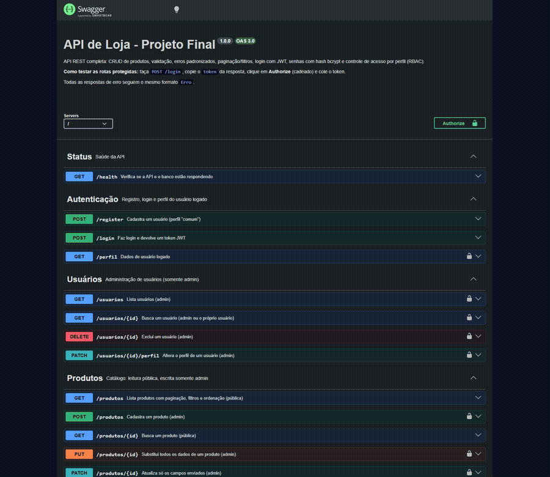
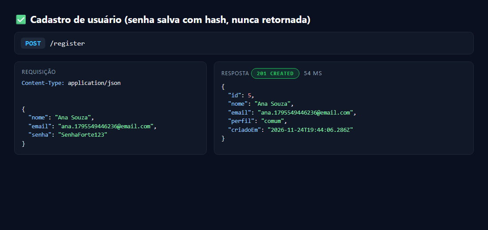
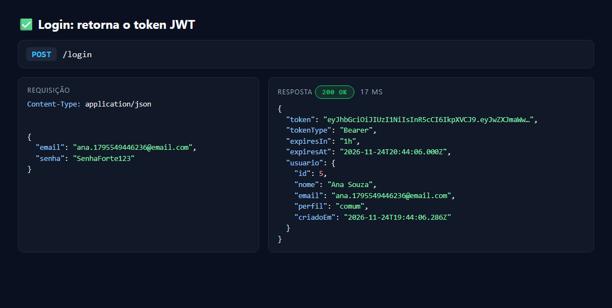
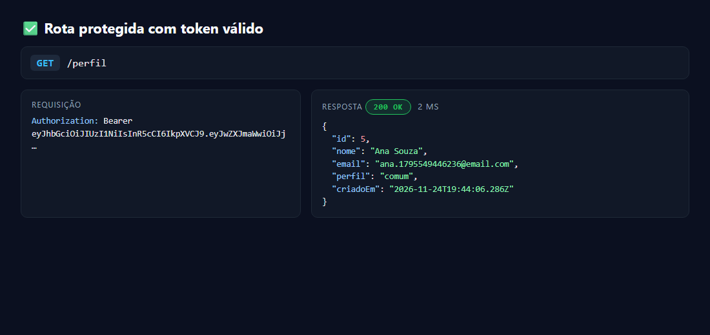
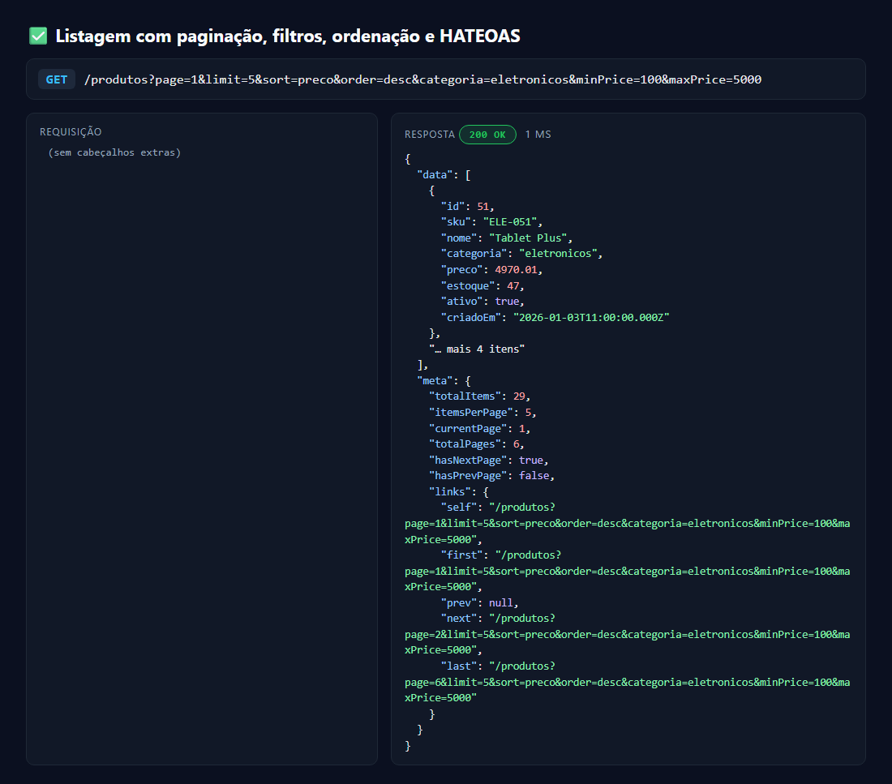
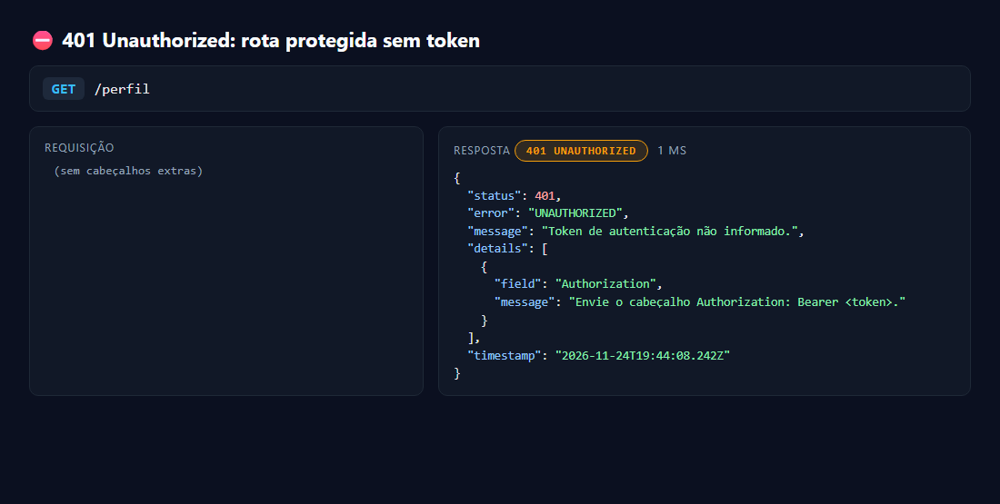
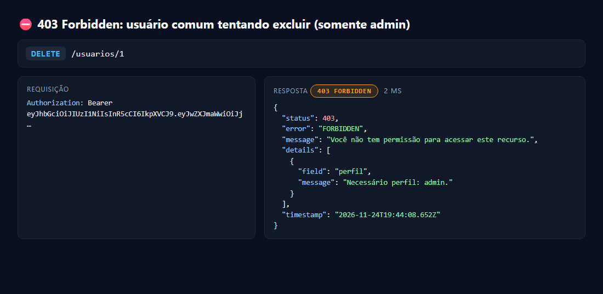
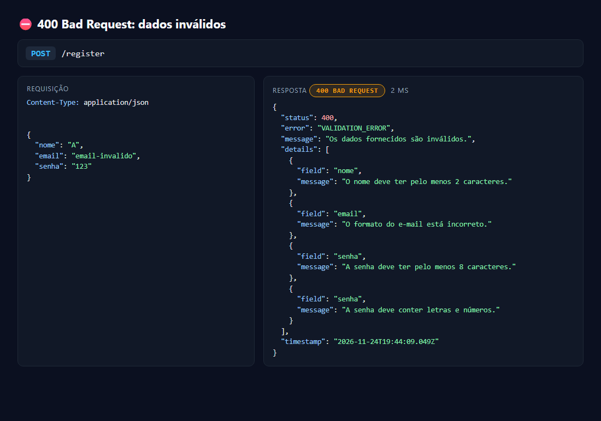
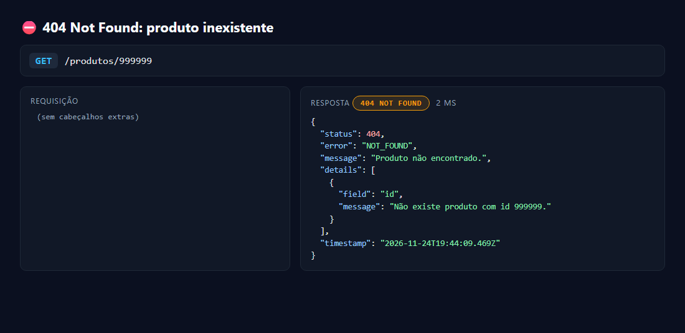

# API de Loja: Projeto Final (API REST completa)

> 🌐 **Deploy:** _link do Render será adicionado aqui após a publicação_ · 📘 **Swagger em produção:** `<deploy>/api-docs` · 🩺 **Health:** `<deploy>/health`

[](https://github.com/marciowsz/api-rest-projeto-final/actions/workflows/ci.yml)



Entregável da **Semana 8** (projeto final) de Desenvolvimento de APIs e Backend. Reúne **tudo o que foi construído no semestre** em uma API de loja (usuários e produtos):

| Semana | Conceito | Repositório |
|---|---|---|
| 5 | Validação (Zod), exceções customizadas, erro padronizado | [api-validacao-erros](https://github.com/marciowsz/api-validacao-erros) |
| 6 | Paginação, ordenação, filtros, metadados e HATEOAS | [api-paginacao-filtros](https://github.com/marciowsz/api-paginacao-filtros) |
| 7 | Hash bcrypt, JWT, RBAC e Swagger | [api-autenticacao-jwt](https://github.com/marciowsz/api-autenticacao-jwt) |
| **8** | **CRUD completo, testes, coleção Postman, evidências, segurança para produção e deploy** | este repositório |

**Autor:** Marcio Rogério Reis Freire Junior ([@marciowsz](https://github.com/marciowsz))

## Stack

**Node.js 24 · Express 4 · SQLite nativo (`node:sqlite`) · Zod · bcryptjs · jsonwebtoken · Swagger UI (OpenAPI 3) · Helmet · CORS · express-rate-limit · Morgan · node:test + Supertest · Postman/Newman · GitHub Actions · Render**

## Como rodar localmente

```bash
git clone https://github.com/marciowsz/api-rest-projeto-final.git
cd api-rest-projeto-final
npm install
cp .env.example .env      # defina JWT_SECRET (32+ caracteres) e ADMIN_SENHA
npm start                 # http://localhost:3000  ·  Swagger: http://localhost:3000/api-docs
```

```bash
npm test                  # 79 testes automatizados
npm run test:api -- --env-var adminSenha=<ADMIN_SENHA>   # coleção Postman via Newman (API rodando)
```

O banco é o SQLite nativo do Node: não é preciso instalar nada. Ele sobe com **150 produtos** de exemplo e com o **admin** definido no `.env`.

## Estrutura

```
src/
├── app.js                   # Express: segurança, docs, rotas, 404 e handler global
├── server.js                # inicialização (cria o admin do .env)
├── config/env.js            # configurações e segredos SOMENTE via variáveis de ambiente
├── routes/                  # auth.routes.js · usuarios.routes.js · produtos.routes.js
├── middlewares/             # auth.js (JWT + RBAC) · validate.js (Zod) · errorHandler.js
├── schemas/schemas.js       # contratos de entrada (body e query)
├── services/                # regras de negócio
├── errors/AppError.js       # exceções customizadas (400, 401, 403, 404, 409, 422)
├── docs/openapi.js          # documentação Swagger/OpenAPI 3
├── db/                      # banco + seed
└── utils/                   # paginação/HATEOAS, logger, asyncHandler
test/                        # 79 testes (api, paginação, auth, final)
docs/
├── demo.gif                 # demonstração
├── evidencias/              # prints das requisições e respostas
└── postman/                 # coleção exportada (JSON)
api.http                     # bônus: requisições prontas apontando para o deploy
render.yaml                  # blueprint de deploy no Render
```

## Endpoints

| Método | Rota | Acesso | Descrição |
|---|---|---|---|
| `GET` | `/health` | público | Saúde da API e do banco |
| `POST` | `/register` | público | Cadastro (perfil `comum`, senha em hash) |
| `POST` | `/login` | público | Login, retorna o JWT |
| `GET` | `/perfil` | logado | Usuário do token |
| `GET` | `/produtos` | público | Lista com `page`, `limit`, `sort`, `order`, `categoria`, `ativo`, `search`, `minPrice`, `maxPrice` |
| `GET` | `/produtos/:id` | público | Detalhe |
| `POST` | `/produtos/:id/baixa-estoque` | logado | Compra (422 se faltar estoque) |
| `POST` | `/produtos` | **admin** | Cria |
| `PUT` | `/produtos/:id` | **admin** | Substitui |
| `PATCH` | `/produtos/:id` | **admin** | Atualiza campos |
| `DELETE` | `/produtos/:id` | **admin** | Exclui |
| `GET` | `/usuarios` | **admin** | Lista usuários (paginado) |
| `GET` | `/usuarios/:id` | admin ou o próprio | Detalhe |
| `PATCH` | `/usuarios/:id/perfil` | **admin** | Promove ou rebaixa |
| `DELETE` | `/usuarios/:id` | **admin** | Exclui |

Todo erro segue o mesmo formato: `{ "status", "error", "message", "details": [{ "field", "message" }], "timestamp" }`.

---

## Parte 1: Revisão de código (code review)

### Funcionalidades das semanas anteriores integradas e funcionando

| Requisito | Onde | Evidência |
|---|---|---|
| **CRUD básico** | `produtos.routes.js` (POST, GET, PUT, PATCH, DELETE) | testes `final.test.js` |
| **Tratamento global de exceções** | `errorHandler.js` + `AppError.js` | 400/401/403/404/409/413/422/429/500 no mesmo formato |
| **Paginação e filtros** | `GET /produtos` + `utils/paginacao.js` | `paginacao.test.js` (23 testes) |
| **Autenticação JWT e RBAC** | `middlewares/auth.js` | `auth.test.js` (34 testes) |
| **Documentação** | `/api-docs` (Swagger UI) | [print](docs/evidencias/00-swagger-ui.png) |

Melhorias feitas nesta revisão:
- **CRUD completo:** foram adicionados `PUT` (substitui) e `PATCH` (parcial; corpo vazio dá 400), com checagem de SKU duplicado.
- **Helmet:** cabeçalhos de segurança (HSTS, `nosniff`, proteção contra *clickjacking*), e o `X-Powered-By` foi removido.
- **Rate limit** em `/login` e `/register`: 20 tentativas a cada 15 minutos por IP. Passando disso, a API responde 429 no padrão de erro, como proteção contra força bruta.
- **CORS** configurável por variável de ambiente, expondo `X-Total-Count` para o frontend.
- **`/health`** para a plataforma de deploy monitorar e para "acordar" a API antes da apresentação.
- **`trust proxy`** em produção, para que o rate limit enxergue o IP real atrás do proxy do Render.

### Nenhum segredo exposto

- O `JWT_SECRET` e a senha do admin vêm **somente** de variáveis de ambiente ([`config/env.js`](src/config/env.js)). A API **se recusa a subir** sem um segredo de pelo menos 32 caracteres.
- O `.env` está no [`.gitignore`](.gitignore). Só o [`.env.example`](.env.example), com valores de exemplo, é versionado.
- No Render, o `JWT_SECRET` é **gerado pela própria plataforma** (`generateValue: true`) e a `ADMIN_SENHA` é pedida na criação (`sync: false`). Nenhum dos dois aparece no repositório.
- Um teste ([`final.test.js`](test/final.test.js)) **varre o `src/`** procurando segredos fixos no código e confere que o `.env` está no `.gitignore`.
- O banco não guarda senhas (só hash bcrypt), e nenhuma resposta devolve `senha` ou `senha_hash`.

---

## Parte 2: Testes e evidências de funcionamento

### Coleção de testes (Postman)

[`docs/postman/api-loja.postman_collection.json`](docs/postman/api-loja.postman_collection.json) traz **24 requisições e 47 asserções**, com scripts que salvam o token automaticamente:

| Pasta | Requisições |
|---|---|
| **1 · Fluxos de sucesso** | health, **cadastro (201)**, **login com retorno do token (200)**, **rota protegida (200)**, login admin, listagem paginada e filtrada, criar produto, PATCH, compra |
| **2 · Erros esperados** | **401** sem token, **401** token inválido, **401** senha errada, **403** comum excluindo usuário, **403** comum criando produto, **400** dados inválidos, **400** registro como admin, **400** JSON malformado, **400** paginação inválida, **404** produto inexistente, **404** rota inexistente, **409** e-mail duplicado, **422** estoque insuficiente |
| **3 · Limpeza** | exclui o produto e o usuário de teste |

**Como usar:** no Postman, clique em **Import** e escolha o arquivo. Ajuste as variáveis `baseUrl` e `adminSenha` e clique em **Run collection**. Pela linha de comando, use `npm run test:api`. O **GitHub Actions roda a coleção a cada push** contra a API real (além dos 79 testes automatizados).

### Evidências (prints em [`docs/evidencias/`](docs/evidencias))

| | |
|:-:|:-:|
| **Cadastro: 201**  | **Login com token: 200**  |
| **Rota protegida: 200**  | **Paginação, filtros e HATEOAS: 200**  |
| **Sem token: 401**  | **Perfil errado: 403**  |
| **Dados inválidos: 400**  | **Não encontrado: 404**  |

**Swagger UI** ([print](docs/evidencias/00-swagger-ui.png)) e **coleção executada com 0 falhas** ([print](docs/evidencias/09-colecao-postman-newman.png)).

---

## Parte 3: Deploy e apresentação

### Deploy no Render (gratuito)

O repositório já vem com o [`render.yaml`](render.yaml) (*Blueprint*):
1. Entre em [render.com](https://render.com) com a conta do GitHub.
2. Vá em **New → Blueprint** e selecione `marciowsz/api-rest-projeto-final`.
3. Informe a `ADMIN_SENHA` quando o Render pedir. O `JWT_SECRET` é gerado automaticamente.
4. Clique em **Apply**. O Render roda `npm ci`, sobe com `npm start` e monitora o `/health`.

Depois do deploy, o **Swagger fica acessível em produção** em `https://<seu-app>.onrender.com/api-docs`, e o **Authorize** funciona do mesmo jeito.

> **Antes da apresentação:** o plano gratuito "dorme" após 15 minutos sem uso, e a primeira requisição pode levar cerca de 1 minuto. Faça o aquecimento abrindo `/health` alguns minutos antes. O banco SQLite é recriado a cada reinício, com os 150 produtos e o admin, o que deixa a demonstração sempre previsível. Em um sistema real, o próximo passo seria um PostgreSQL gerenciado.

### Bônus: arquivo `.http`

[`api.http`](api.http) traz todas as requisições (sucesso e erros) com a **URL base apontando para o deploy**. Basta abrir no VS Code com a extensão REST Client e clicar em **Send Request**. O token do login é reaproveitado automaticamente nas requisições seguintes.

### Roteiro da apresentação (10 minutos)

| Tempo | Parte | O que mostrar |
|---|---|---|
| 0:00 a 1:00 | **Abertura** | Problema (API de loja), stack e evolução das Semanas 5 a 8 (tabela do topo) |
| 1:00 a 2:30 | **Arquitetura** | Camadas: rotas → middlewares (validate, auth) → services → banco, e o handler global no fim. Estrutura de pastas |
| 2:30 a 4:30 | **Swagger em produção** | `/api-docs` no deploy: registrar, login, **Authorize**, `GET /perfil` (200) |
| 4:30 a 6:00 | **Paginação e filtros** | `GET /produtos?page=2&limit=5&sort=preco&order=desc&categoria=eletronicos` e os links HATEOAS do `meta` |
| 6:00 a 7:30 | **Erros planejados** | 401 (sem token), 403 (comum excluindo), 400 (dados inválidos), 404, 422 (estoque), **todos no mesmo formato**. Mostrar que o 500 não vaza o stack trace (teste) |
| 7:30 a 8:45 | **Qualidade** | GitHub Actions verde: 79 testes + coleção Postman (24 requisições, 0 falhas). Segredos fora do código |
| 8:45 a 10:00 | **Fechamento** | Reflexão (Parte 4) e próximos passos (PostgreSQL, refresh token) |

---

## Parte 4: Reflexão

### Qual a diferença entre "funciona na minha máquina" e "está pronto para produção"? Por que a tríade Documentação (Swagger), Testes (Coleções/QA) e Deploy (Nuvem) é o que separa um projeto de estudante de um projeto profissional?

Na **máquina do desenvolvedor**, o ambiente é perfeito: um único usuário (ele mesmo), rede local sem latência, dados que ele conhece, variáveis configuradas à mão, o banco sempre de pé e a certeza de qual comando rodar. "Funciona na minha máquina" prova apenas que **o caminho feliz funciona naquelas condições**.

**Produção** é o oposto:
- **Rede:** latência, timeouts, proxies e HTTPS. A API roda atrás do proxy do Render, e por isso foi preciso configurar o `trust proxy`.
- **Segurança:** a API fica exposta na internet, para qualquer pessoa, inclusive mal-intencionada. Daí o rate limit no login, o Helmet, a validação de toda entrada, os tokens com expiração e os segredos fora do código.
- **Concorrência:** muitos usuários ao mesmo tempo, comprando o mesmo produto e logando juntos.
- **Ambiente diferente:** outro sistema operacional, outra versão de dependências, sem o `.env` da sua máquina. Daí o `render.yaml`, o `npm ci` com lockfile e o `engines` no `package.json`.
- **Falhas reais:** o banco cai, o servidor reinicia, a plataforma "dorme". A API precisa **falhar de forma elegante** (500 genérico, log interno, `/health`) em vez de travar ou vazar informação.

A **tríade** é o que torna o sistema **resiliente e previsível** fora da máquina de quem o escreveu:

- **Documentação (Swagger):** é o contrato. Qualquer pessoa (frontend, professor, outro time) sabe o que a API faz e como usá-la sem perguntar ao autor e sem ler o código. Ela também torna explícito o que é protegido (cadeados, respostas 401/403). Sem documentação, o sistema depende de uma pessoa.
- **Testes (coleções e QA):** são a **prova**, e não a promessa, de que tudo funciona, incluindo os erros. Os 79 testes e a coleção Postman rodam **automaticamente a cada push** no GitHub Actions. Assim, uma mudança que quebra o login ou deixa um usuário comum excluir dados é detectada **antes** de chegar ao usuário. Sem testes, toda alteração é um risco.
- **Deploy (nuvem):** é o que transforma código em **produto acessível**. Fazer o deploy força a resolver tudo o que "na minha máquina" ficava escondido: variáveis de ambiente, segredos, versão do Node, porta, health check e o comportamento de *cold start*. Sem deploy, o sistema não existe para ninguém além do autor.

Um projeto de estudante responde à pergunta "funciona?". Um projeto **profissional** responde também:
- **"Como eu uso?"** → documentação;
- **"Como eu sei que continua funcionando?"** → testes automatizados;
- **"Onde está rodando, e com segurança?"** → deploy.

É essa disciplina, e não a quantidade de linhas de código, que separa os dois.
